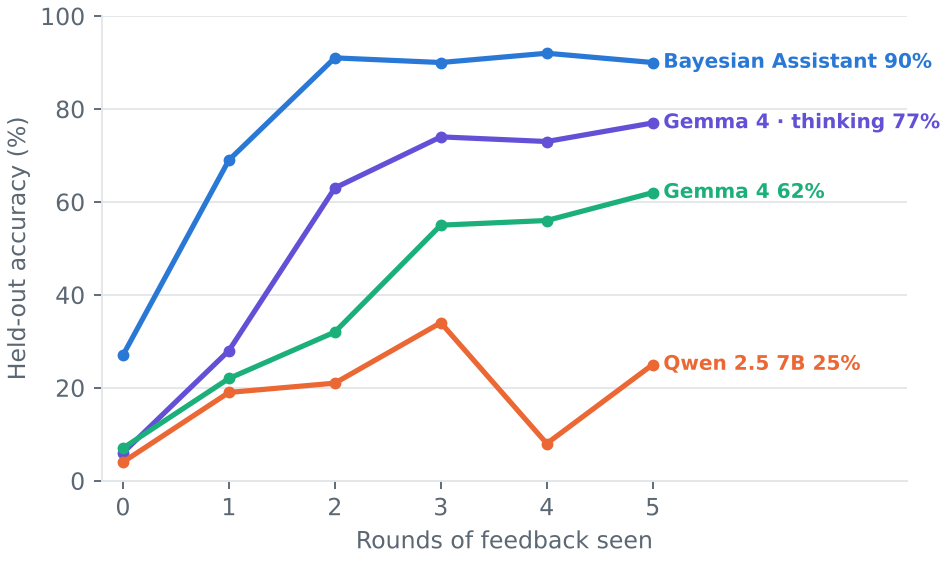
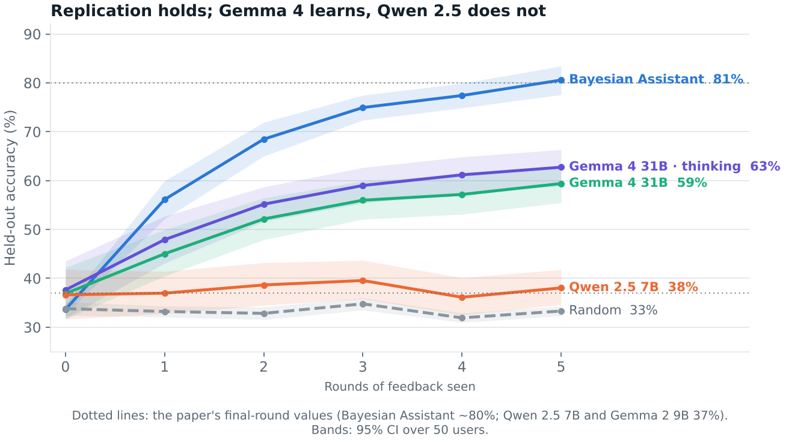
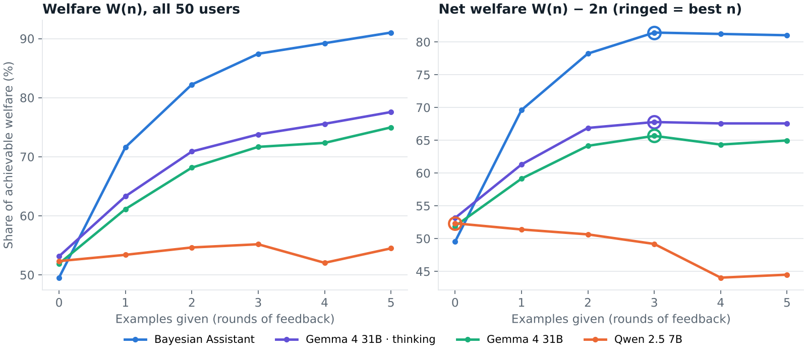
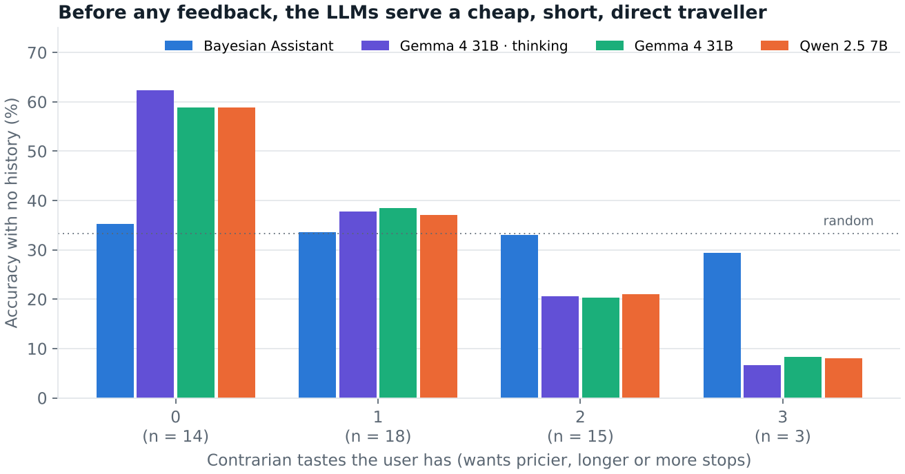
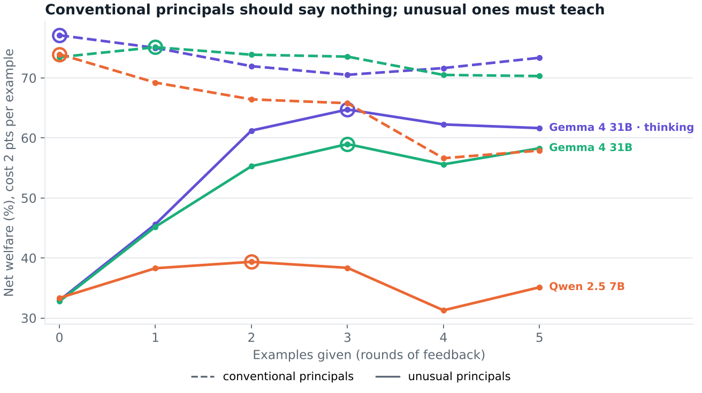

# Delegating preferences

*Replicating Qiu et al. (2026) with newer LLMs, and pricing what it costs to teach an AI agent what you want.*

**Contents:** [Why this matters](#why-this-matters) · [The experiment](#the-experiment) · [Replication and newer models](#replication-and-newer-models) · [Trying to price the cost of instruction](#trying-to-price-the-cost-of-instruction) · [A principal–agent reading](#a-principalagent-reading) · [Unusual principals and strong defaults](#unusual-principals-and-strong-defaults) · [Reproducing it](#reproducing-it)

## Why this matters

The biggest delegation problem we're going to face is gradually handing more and more decision-making power to AI agents. Partly for convenience: "friction" is the metaphor of choice in tech for the small, thoughtless activities that slow us down, and agents are yet another way of removing it. This is the advent of the personal agent. Partly to extend our reach: until now, the only way to cope with capacity was an extra pair of hands. Software eased that, and it was with software that we began to see millions of dollars of revenue per person. Agents very much feel like the culmination of that.

There's something promising, and frankly a little scary, about extending one's exact preferences across a swarm of AI agents. Delegating has always meant aligning many people's interests and telling a captivating story (even the strictest, most authoritarian people have had to). With agents, that constraint starts to disappear.

But nonetheless, the question of: how efficiently do these agents translate our preferences? Adjacently, whose preferences are embedded in the models themselves, likely from pre-training and RLHF emphases? Kirk et al. (2024) find that RLHF generalises better than supervised fine-tuning but significantly reduces output diversity: post-training pulls a model away from the spread of what people do and towards one preferred answer. And which types of preferences take more care to communicate to them?

## The experiment

Qiu et al. (2026) set out to show how Bayesian learning can be used as a training objective, a novel form of teaching that overcomes LLMs' failure to update their beliefs across interactions. Dually, and the contribution of this extension here, it can be read through an economics angle: how efficiently can we translate our preferences into LLMs?

The experiment simulates a user whose utility function we know. Flights are described by four features, departure time, duration, number of stops and price, each scaled to between 0 and 1, and the user's utility is linear in them: a weight from −1 to 1 on each, so a user can like or dislike any feature, or not care.

```math
U_i(f) = \theta_i^{\top}\varphi(f), \qquad \varphi(f) \in [0,1]^4, \qquad \theta_i \in \left\{-1, -\tfrac{1}{2}, 0, \tfrac{1}{2}, 1\right\}^4
```

The model is shown a menu of three flights and picks one; the user says whether it was right, and which flight they'd have picked. In the first round there is no history, so it is basically a guess. The clever part is that this runs for five rounds, so we can see how much better the model gets as it sees more of the user's past choices. After each round the conversation is frozen and the model is tested on 100 new menus without feedback, so we measure what it has learned rather than what it was told.

The benchmark is a Bayesian learner. It's a little bit of cheating: it knows the functional form of the user's utility, which the LLM doesn't. It starts with every weight vector equally likely, throws out those that contradict a choice the user has made, and recommends the flight that is best on average over what remains. It is the information optimum: how much can be learned from these examples at all.

```math
H_t = \{\theta : \theta \text{ consistent with every pick so far}\}, \qquad
\hat f_t = \operatorname*{arg\,max}_{f}\; \mathbb{E}\left[\theta \mid H_t\right]^{\top}\varphi(f)
```

To make this concrete, here is one user, round by round, with Gemma 4 31B (thinking) as the agent.

> **User 343** doesn't care when they fly, mildly prefers longer flights with more stops, and strongly prefers pricier ones: $`\theta = (0, \tfrac12, \tfrac12, 1)`$.
>
> **Round 1**
>
> | | Departure | Duration | Stops | Price | |
> |---|---|---|---|---|---|
> | Flight 1 | 5:12 PM | 16 h 6 m | 2 | $190 | |
> | Flight 2 | 3:36 PM | 12 h 12 m | 2 | $370 | ← Gemma |
> | Flight 3 | 10:48 AM | 16 h 6 m | 2 | $640 | ← user |
>
> *"Since I have no previous history with this user, I have to make a 'best judgment' guess about what a typical traveler prefers."* Gemma picks Flight 2: *"Your option Flight 2 is incorrect. I prefer Flight 3."*
>
> **Round 2.** *"Hypothesis: The user prefers morning departures, regardless of price or duration."* Wrong again. The user wanted the $730 flight.
>
> **Rounds 3–5.** *"The user prefers the most expensive flight."* Right three times in a row.



On the 100 held-out menus, Gemma (thinking) goes from 6% to 77% and the Bayesian learner from 27% to 90%; Qwen never gets above chance. Gemma's round 0 is not a coin flip: it starts from a typical traveller, cheap, short and direct, which is exactly wrong for this user. We come back to that.

## Replication and newer models

The paper's basic finding was that, back when they tested this, LLMs were very poor at learning from past interactions to infer something about future choices. We replicate it with the paper's own users and menus and its weakest model, Qwen 2.5 7B, then run Gemma 4 31B with and without thinking.

| Design | |
|---|---|
| **Users** | 50 simulated, stratified by preference strength |
| **Rounds** | 5, with feedback after each pick |
| **Test** | 100 held-out menus after each round, no feedback; 605 decisions per user and agent |
| **Agents** | Qwen 2.5 7B · Gemma 4 31B · Gemma 4 31B thinking · Bayesian learner |
| **Outcomes** | Accuracy (picks the user's flight); share of achievable welfare |



The replication holds: Qwen lands at 38% against the paper's 37%, flat after the first round. The picture for newer models is different.

| Final-round accuracy (%) | Paper | Ours |
|---|---:|---:|
| Bayesian learner | ≈80 | 80.6 |
| Qwen 2.5 7B | 37 | 38.0 |
| Gemma 2 9B → Gemma 4 31B | 37 | 59.4 |
| Gemma 4 31B, thinking | – | 62.7 |

Compared to the original experiment, the models have gotten substantially better. Gemma 4 is an open model, not the frontier, and it's roughly a doubling of the score. Measured above chance (33%), the learning signal went from about 4 points to 26–30. Thinking adds a little (+3.4 points, 95% CI 1.8–5.0) without changing how fast the model learns. The gap to the Bayesian learner (which, remember, has a strictly greater informational basis) is still pretty surprising.

## Trying to price the cost of instruction

From an economic angle this is very close to a standard setup. A consumer has a utility function, and has delegated their choices to a personal assistant who can only learn from past examples. The relevant metric is how good this assistant is at understanding my preferences, and we can express that as welfare: on each menu, the share of the achievable utility range the agent's pick delivers, where 0 is the worst flight on the menu and 100 the best. Picking at random gives about 50.

```math
w_i(\text{menu}) = \frac{U_i(\text{agent's pick}) - \min_f U_i(f)}{\max_f U_i(f) - \min_f U_i(f)}, \qquad W(n) = 100 \cdot \overline{w_i}
```

Each example I provide is a cost, and the welfare the agent delivers is the benefit. The cost is the principal's time and attention: choosing, correcting, explaining. We assume for now that it is linear, a cost $`c`$ per example, measured in points of welfare. Net welfare and the best number of examples are then:

```math
\mathrm{NW}(n; c) = W(n) - c \cdot n, \qquad n^*(c) = \operatorname*{arg\,max}_{n \in \{0, \dots, 5\}} \mathrm{NW}(n; c)
```

And we get the classic trade-off curve: there's a benefit to specifying, as the agent gets better, but also a cost. With a cost of 2 points per example, net welfare rises, peaks and flattens: everyone except Qwen should give about three examples.



The curves also give an exchange rate between agents. Five rounds with Gemma (thinking) buy the same welfare as about 1.6 rounds with the Bayesian learner (95% CI 1.2–1.9); for Qwen it is 0.2. Put differently, the principal of the best LLM has to give roughly three times as many examples to get the same welfare.

## A principal–agent reading

This is a little dissimilar to the usual setups. When a principal delegates a task, one can decompose it along three components, all necessary for good delegation:

- **Interest alignment:** to what extent do the principal's interests transmit to the agent? Does the agent want what the principal wants?
- **Learning efficiency:** how much does each example teach it?
- **Default rule:** what is the baseline when the principal has said nothing?

The last two are the interesting ones. When we hire someone with law experience, their baseline is quite high: they know what to act on, what to do. Compare that to a junior, who may have a poor default rule but a higher learning efficiency. In the curves above, learning efficiency is the slope and the default rule is the intercept at zero examples.

Orthogonal to both is interest alignment: is there an antagonistic relationship between the principal and the agent? For language models, training addresses this head-on. The RLHF step has it as the explicit intent, aligning the model with the preferences of humans rating a whole bunch of answers. The more modern flavour, reinforcement learning from verifiable rewards (RLVR), does it indirectly: the model is given an explicit task and judged on whether it reaches the goal. So in this kind of delegation, the interest problem is essentially short-circuited.

Unlike the classic case of optimal delegation to a biased agent (Alonso & Matouschek, 2008), there's no real bias in the agent we're delegating to here. There are fringe cases: the AI labs also run strong research programmes to make sure models can't be used for harm, and in those cases the agent is deliberately biased against some principals. But on the whole, we can think of these agents as faithful delegates. The real problem is capability: for now they are simply unable to take in the signal.

That's true for the Bayesian learner, but not for the LLMs, and round 0 is where the agent's own preferences show.

## Unusual principals and strong defaults

What I said about no bias isn't quite true. If we analyse the round-0 traces, there's a direct preference for cheap, short, direct flights. The model doesn't act as an agnostic agent with no information; it presumes some baked-in things, very likely from its training data.



With no information, all three models serve the same default traveller. They're right about 60% of the time for users who share that taste and 7–8% for users who want the opposite on everything. In 60% of round-0 traces, the reasoning appeals to what "a typical traveller" wants. The Bayesian learner, with a flat prior, sits at chance for everyone. And the default isn't only a starting point: for users who don't care about price, Gemma keeps filling in a preference for cheap flights even after five rounds of feedback.

> **User 202** likes direct, early and somewhat longer flights, and does not care about price: $`\theta = (-\tfrac12, \tfrac12, -1, 0)`$. After five rounds of feedback, Gemma (thinking) writes:
>
> *"Round 5 — Result: F2 (0 stops, cheap, but long duration). Inference: 0 stops is very important. Price is important. Duration is less important than stops."*
>
> *"Preference 1: 0 stops (strongest preference). Preference 2: Morning departure. Preference 3: Price (generally prefers lower price, but 0 stops and time of day seem to override it)."*
>
> The direct flight the user picked in round 5 happened to be cheap. The model reads that coincidence as a taste for low prices, which is what its default expects.

This is where unusual principals come in. Some preferences are unusual by definition: preferring longer flights, pricier flights, more stops. We call a principal unusual if they prefer the odd direction on at least two of the three (18 of 50 users), and conventional if on none (14). The 18 in between are left out.

```math
D_i = \mathbf{1}\left[\, \#\{k \in \{\text{duration}, \text{stops}, \text{price}\} : \theta_{ik} > 0\} \ge 2 \,\right]
```

Splitting the net-welfare curves by principal type, and comparing only the LLMs, the default rule turns out to decide how much instruction pays. A conventional principal starts at 73–77% of achievable welfare with no examples, already better than the Bayesian learner after one round (72%), and the models barely improve from there. For them, every example is mostly cost. An unusual principal starts at 33%, below random, and has to teach the agent; Gemma (thinking) gets them to 72%, still well short of the Bayesian learner's 90%.



The table reads the same curves across costs. Once an example costs more than about a point of welfare, a conventional principal is best off telling the agent nothing, while an unusual one should still give two or three. For the Bayesian learner, the two types are treated identically. The default serves the typical principal for free and taxes the unusual one.

| Best number of examples $`n^*`$ | $`c=0`$ | $`c=1`$ | $`c=2`$ | $`c=4`$ | $`c=8`$ |
|---|---:|---:|---:|---:|---:|
| ***Conventional principals (n = 14)*** | | | | | |
| Gemma 4 31B, thinking | 5 | 5 | 0 | 0 | 0 |
| Gemma 4 31B | 5 | 3 | 1 | 0 | 0 |
| Qwen 2.5 7B | 0 | 0 | 0 | 0 | 0 |
| ***Unusual principals (n = 18)*** | | | | | |
| Gemma 4 31B, thinking | 5 | 3 | 3 | 3 | 2 |
| Gemma 4 31B | 5 | 5 | 3 | 3 | 2 |
| Qwen 2.5 7B | 5 | 2 | 2 | 1 | 0 |
| ***Either type*** | | | | | |
| Bayesian learner | 5 | 5 | 3 | 3 | 2 |

*Cost $`c`$ in points of welfare per example.*

### References

- Alonso, R. & Matouschek, N. (2008). Optimal delegation. *Review of Economic Studies* 75(1), 259–293.
- Kirk, R. et al. (2024). Understanding the effects of RLHF on LLM generalisation and diversity. *ICLR 2024*.
- Qiu et al. (2026). Bayesian teaching enables probabilistic reasoning in large language models. *Nature Communications* 17, 1238.

---

## Reproducing it

Everything above comes from the data and code in this repository. The LLM calls are logged, so every figure and table regenerates offline without an API key.

### Setup

Python 3.11+ and [uv](https://docs.astral.sh/uv/).

```bash
uv sync
uv run python scripts/download_paper_data.py   # the paper's users and menus, Zenodo 17677329 → data/paper/ (git-ignored)
uv run pytest                                  # 44 tests
```

### Regenerate the figures and tables

```bash
uv run python analysis/delegation/make_figures.py   # figures 1–3, 5–7 and summary.json
uv run python analysis/delegation/user343.py        # figure 4 (the walkthrough user)
uv run python scripts/analyse_results.py results/main
```

LaTeX versions of the tables and welfare definitions are in `analysis/delegation/latex/` (`tables.tex`, `welfare.tex`; rendered to `render.pdf` and PNGs).

### Rerun the experiment

```bash
export OPENROUTER_API_KEY=...
uv run python scripts/run_experiment.py --config configs/main.toml [--max-cost USD] [--push-every SECONDS]
```

Every call is logged under `results/<run_id>/calls/<arm>/<user>.jsonl.gz`, keyed by sha256(model, provider, messages, params). Rerunning the same config reuses the log and only pays for missing calls, so with the committed logs the main run replays for free. Each run writes `manifest.json` and `decisions.parquet` (242,000 decisions for the main run). The main run cost about $23 on OpenRouter.

### Repository layout

| Path | What it holds |
|---|---|
| `src/flight_prefs/` | Paper data loader, utility, Bayesian learner, simulated and LLM agents, prompts, answer parsing, rate-limited OpenRouter client, call log, interaction loop |
| `configs/` | Run configs: `main.toml` (the run reported here), `pilot.toml`, `s2_one_llm.toml`, `probe_friendli.toml` |
| `results/main/` | The main run: decisions, call logs, manifest, analysis tables |
| `results/{simulated,s2-one-llm,pilot,pilot2,probe-friendli}/` | Earlier gates and pilots |
| `analysis/delegation/` | Figures, tables and LaTeX for this write-up |
| `analysis/explore/` | Exploratory data mining of the main run (notes in `NOTES.md`; one-off scripts, kept as run) |
| `analysis/draft/` | The HTML draft this README was written from |
| `scripts/` | Experiment runner, analysis, cost estimate, and the S0–S3 gate checks |

### Build gates

The experiment was built in slices, each with a gate that had to pass before the next.

| Slice | Command | Gate |
|---|---|---|
| S0 | `scripts/check_bayesian_assistant.py` | Bayes 33 → 57 → 67 → 73 → 77 → 80% on all 624 users |
| S1 | `scripts/check_simulated_agents.py` | random ≈ 33%, oracle 100% with regret 0, 605 decisions per user |
| S2 | `run_experiment.py --config configs/s2_one_llm.toml`, then `scripts/check_one_llm.py` | 605 parsed replies, 0 duplicate calls after kill + resume, transcript as the paper's Table H3 |
| S3 | `run_experiment.py --config configs/pilot.toml`, then `analyse_results.py`, `estimate_cost.py`, `check_pilot.py` | 0 unparsed, providers stable, thinking cap binds < 5%, main run projected < $20 |
| S4 | `run_experiment.py --config configs/main.toml` | 50 users × 3 LLM agents + Bayesian learner and simulated agents |

### Method notes

**Models and providers.** All models run through OpenRouter at temperature 0. Qwen 2.5 7B runs on Phala, its only provider. Both Gemma 4 31B arms run on Friendli, whose quantisation is not stated: Crusoe (bf16) was throttled by OpenRouter's shared pool, and Friendli's picks match Crusoe's on 96% of identical prompts in the pilot.

**Thinking cap.** Providers ignore `reasoning.max_tokens`, so the cap is the output limit: 1,056 tokens (1,024 thinking + 32 answer). A call cut off there gets one follow-up with thinking off: the partial thinking as the assistant's turn, then "Stop thinking and answer now. Answer with exactly one sentence of the form 'The best option is Flight N.'". Those picks have `forced = True` in `decisions.parquet`. `scripts/forced_selection.py` checks that the gap between forced and unforced picks is selection (harder items get cut off), not damage from forcing.

**Prompts and parsing.** Wording is from the paper's Supplementary Table H3; the chat layout and the "Your option Flight N is correct." line come from the paper's own Zenodo training dialogues. Past assistant turns are re-sent as exactly "The best option is Flight N.". A pick is read only from an explicit declaration ("The best option is Flight N", "Flight N is the best option", …) or a bare "Flight N". Anything else gets one retry with a format reminder; if that fails too, the pick is scored wrong (with worst-option regret) and reported, never dropped. Qwen needs the reminder for every round-0 prompt: unprompted, it starts an analysis that its 16-token limit cuts off.

**Data.** The interaction file's menus are mapped to features with a per-feature text → value lookup built from the held-out file; it covers every flight and agrees with the file's own `rounds_numpy`. `data/user_sample.json` holds all 624 users in a seeded order, stratified by $`\lVert\theta\rVert`$ into five groups (88/144/88/96/208), so any prefix keeps the mix; the main run uses the first 50.

**Scoring.** Accuracy is scored against the paper's labelled choice. 5.3% of held-out (user, menu) pairs are ties under $`\theta`$ and the paper's labels break those at random, so tie-aware accuracy is reported too. The Bayesian learner keeps every $`\theta`$ under which each user choice is a best option (uniform prior over the 624 non-zero $`\theta`$), picks $`\arg\max\, \mathbb{E}[\theta]^{\top}\varphi`$, and breaks ties at random, seeded by state and menu.

**Principal types.** The unusual/conventional split was defined after seeing the data. A pre-registered run on about 20 new unusual principals would confirm it.
